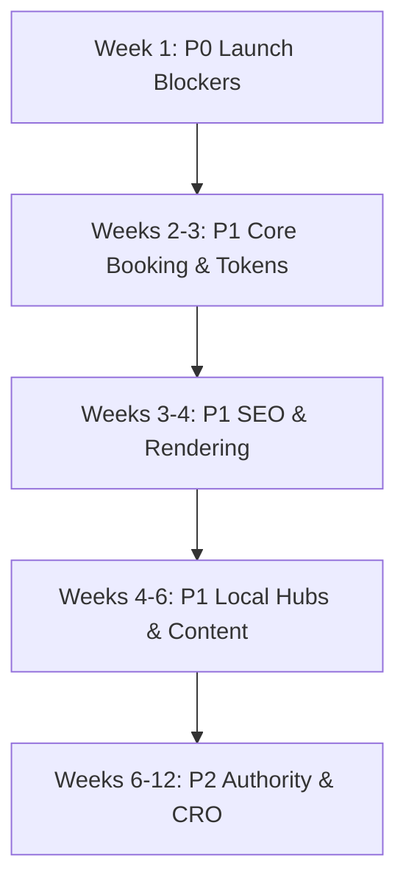

# QXL • WEBSITE IMPLEMENTATION BLUEPRINT

**QXL DIAGNOSTICS — Complete Website Implementation Blueprint**  
*Mobile • Tablet • Desktop | Technical SEO • Local SEO • AI Search • Patient Bookings • Hospital Partnerships*

---

- **Document Version:** Implementation Baseline: 24 October 2026
- **Domain:** `https://qxldiagnostics.com`
- **Contact:** `+91 9964 639 639`
- **Target Audience:** Current QXL Diagnostics website developer, operations, medical quality, marketing, and leadership teams.
- **Deliverables:**
  - 87 Actionable tasks with owners and acceptance criteria ([`DELIVERY_CONTROL_CENTRE.md`](./DELIVERY_CONTROL_CENTRE.md))
  - 27-Page canonical route registry
  - 61 Regression / QA test cases
  - Reusable responsive CSS design tokens ([`qxl-design-tokens.css`](./public/qxl-design-tokens.css))
  - Interactive Web Delivery Control Centre ([`/delivery-control-centre`](/delivery-control-centre))
- **Scope Boundary:** Existing LIS, CRM (LeadSquared), payment gateways, report portal, and website backend should be preserved and integrated rather than rebuilt without justification.

---

## Executive Decision Statement
> **Win patient trust and convenient booking before scaling SEO page counts.**  
> Run a separate, credible B2B conversion journey for **Hospital Laboratory Management (HLM)**, **Laboratory Management Services (LMS)**, and **specialised reference testing**.

---

## Non-Negotiable Publication Gates

1. **NABL Accreditation Gate:** Quality Head verifies currently valid MC-6849 certificate and accredited schedule; older certificate expiry is a verification item, not evidence of present status.
2. **Clinical SKU Single Source:** Single approved clinical/commercial SKU source for prices, parameter counts, sample type, fasting, and report timing.
3. **Medical Truth Gate:** Medical lead reviews food-specific IgG sensitivity claims and any AI symptom recommendations prior to publication.
4. **Data Safeguard & Privacy Gate:** Uploads, patient reports, and payments pass strict security controls; **never send patient identifiers or health data to marketing analytics**.
5. **Operational Accuracy Gate:** Operations lead approves real walk-in centres, non-walk-in service hubs, opening hours, and home collection reach.

---

## 1. How Your Developer Should Use This Package

1. **Single Delivery Register:** Import 87 task records from the Delivery Control Centre into Jira/ClickUp/Asana or maintain [`DELIVERY_CONTROL_CENTRE.md`](./DELIVERY_CONTROL_CENTRE.md) as the single delivery register.
2. **Assign Accountability:** Assign Product Owner, Quality Head, Clinical Reviewer, Operations Lead, Security, SEO, and B2B Lead to approve their respective scopes.
3. **Baseline Snapshot:** Record a before-change snapshot: current public routes, rendered HTML, performance baseline, 28-day GSC data, booking analytics, current release, and backup.
4. **Staging & Feature Flags:** Create a staging release branch with feature flags. Map existing API contracts for LIS/test catalog, LeadSquared, report authentication, collection slots, and payments.
5. **P0 Gates Precedence:** Implement all P0 gates before publishing new trust claims or running acquisition campaigns. Integrate shared design tokens before page-by-page cosmetic updates.
6. **Multi-Device & A11y Testing:** Test every step of patient and hospital forms across smartphone, tablet, desktop, and keyboard-only workflows.
7. **Guarded Phased Go-Live:** Go live in guarded phases with signed test evidence, production crawl comparison, and verified rollback path.

---

## 2. Expected Ownership and Responsibility

| Role | Accountability / Sign-Off Area |
| :--- | :--- |
| **Technical Lead** | Frontend, backend, CI/CD, SEO rendering, redirects, tests, uptime |
| **Quality Head** | Current NABL certificate/scope, quality/TAT claims, quality page |
| **Medical Director** | Medical indications, food IgG review, blog/test clinical statements |
| **Operations + Centre Heads** | Centre listings, walk-in vs service hubs, collection availability and hours |
| **Commercial / Accounts** | SKU pricing, MRP, fees, package contents, discounts, invoices |
| **Legal / DPO / Security** | Prescription/report safeguards, privacy copy, consent, storage retention |
| **SEO + Marketing** | IA, canonical strategy, content planning, local profile accuracy, analytics |
| **B2B Lead** | HLM/LMS commercial claims, hospital lead routing, and case study approvals |
| **CEO / Project Owner** | Scope, time/budget trade-offs, final rollout sign-off |

---

## 3. Core Design System — Exact Values

| Token | Exact Hex | CSS Variable | System Use |
| :--- | :--- | :--- | :--- |
| **Corporate Navy** | `#082C61` | `--qxl-corporate-navy` | Main navigation, key headings, footer, executive surfaces |
| **Primary Blue** | `#1055AE` | `--qxl-primary-blue` | Primary booking buttons, active state, core interactive links |
| **Light Blue** | `#EAF6FF` | `--qxl-light-blue` | Quiet hero surfaces, card backgrounds, subtle alert tints |
| **Logo Gold** | `#D69A18` | `--qxl-logo-gold` | Rare highlight only; never used for competing CTAs |
| **Medical Teal** | `#0B9B9A` | `--qxl-medical-teal` | Small non-critical accents; focus indicator when contrast passes |
| **White** | `#FFFFFF` | `--qxl-white` | Primary canvas background, card interiors |
| **Neutral Text** | `#142A43` | `--qxl-neutral-text` | High-contrast body text and clinical reading content |
| **Muted Text** | `#52677D` | `--qxl-muted-text` | Secondary captions, explanatory notes, disclaimers |
| **Surface Border** | `#DCE8F5` | `--qxl-surface-border` | Subtle card dividers, table strokes, form outlines |

### Design Rules
* **File Location:** Use the bundled [`qxl-design-tokens.css`](./public/qxl-design-tokens.css).
* **Spacing:** Strict 8px increment system (8px, 16px, 24px, 32px, 48px, 64px).
* **Card Radii:** 14px to 20px (`rounded-2xl` / `rounded-3xl`).
* **Tap Targets:** Minimum interactive target **44×44px** on touch surfaces.
* **Accessibility:** Visible keyboard focus indicator (`:focus-visible`), reduced-motion support (`@media (prefers-reduced-motion)`), and WCAG 2.2 AA verified contrast.

---

## 4. Responsive Rules and First-Screen Specification

| Viewport | Layout & Navigation Architecture | What Appears Above First Scroll |
| :--- | :--- | :--- |
| **360–767px Mobile** | Single column. Header: logo, phone icon, hamburger menu; full-width search; fixed bottom bar only if it never obscures active form fields. | Prominent Search Bar + **exactly four shortcuts**: <br>1. *Book a Test*<br>2. *Upload Prescription*<br>3. *Home Collection*<br>4. *Health Packages*<br>+ One clear clinical trust line. |
| **768–1199px Tablet** | 2-column card layouts, condensed navigation, visible search and booking cart indicator; 16–24px content padding. | Compact hero with booking/search, verified NABL assurance, and main patient action gateways. |
| **1200px+ Desktop** | Max 1180px content container, 3–4-column directory cards, full navigation bar, purposeful hero section. | Full search, clear value proposition, primary booking CTA, and doctor-led trust evidence. |

> **Critical Frontend Hygiene (Task QXL-003):**  
> Avoid duplicate headers, floating AI widgets covering checkout buttons, autoplay carousels, repeated callback forms, or developer marketing demos.  
> **The public homepage section demonstrating the "Liquid Glass Design System" must be removed from patient HTML**, not merely hidden with CSS.

---

## 5. Patient Journeys — Functional Acceptance

### Journey 1: Search to Booking
* Tests / packages chosen $\rightarrow$ Price and preparation instructions clearly displayed $\rightarrow$ Patient address & pin code serviceability check $\rightarrow$ Real capacity-based time slot selection $\rightarrow$ Verified payment / confirmation.
* Back-navigation preserves all entered form values without reset.
* At checkout completion: Reconciles with LIS/CRM order system and fires exactly **one** server-side conversion event.

### Journey 2: Upload Prescription
* Local file selection / camera capture $\rightarrow$ Strict MIME type (`image/jpeg`, `image/png`, `application/pdf`), max 10MB file size, and malware validation.
* File stored in private, encrypted object storage (Supabase/S3) with zero public access.
* Patient mobile confirmation and DPDP consent collected $\rightarrow$ Unique request tracking ID issued.
* Enquiry automatically routed to LeadSquared CRM with an SLA timer.
* Document access requires short-lived, pre-signed expiring URLs.

### Journey 3: Home Sample Collection
* Pin code entry first $\rightarrow$ Validate supported Bangalore operational area + service constraints.
* Patient selects required tests or uploads prescription $\rightarrow$ Real-time slot availability checked against phlebotomist dispatch capacity.
* Transparent collection fees and preparation disclaimers (fasting, timing).
* Confirmation issued via SMS/WhatsApp with no sensitive PHI exposed in plain text.

### Journey 4: Patient Report Access
* Private, authenticated portal area (`/reports`).
* Patient ownership and order ID verified server-side on every request.
* OTP anti-abuse rate limiting (max 3 failed attempts before lockout).
* Zero third-party marketing analytics scripts loaded; strict `noindex`, `no-store`, and `private` cache-control headers.

### Journey 5: Hospital Laboratory Management (HLM) B2B
* Dedicated B2B hero page (`/hospital-laboratory-management`) addressing hospital pain points: lab quality, turnaround time, staffing shortages, and accreditation.
* Clear service breakdown: Onsite routine/STAT lab operations, super-speciality referral network, digital LIS integration, and commercial joint-venture models.
* Primary CTA: **"Request Laboratory Assessment"**.
* Qualification form collecting hospital name, role, bed capacity band, and business email.
* Leads routed to dedicated B2B CRM pipeline without consumer patient mixing.

---

## 6. Priority Rollout Sequence & Deployment Gates



* **Week 1 / P0 (Regulated Facts & Security):**  
  Correct regulated claims, remove homepage demo, freeze single commercial SKU master, secure prescription uploads and report downloads, capture baseline crawl.  
  *Release Evidence:* Quality, Medical, Legal, Ops, and Security signatures.
* **Weeks 2–3 / P1 (Core UX & Commerce):**  
  Deploy design tokens, simplified 3-step search/booking, standalone home collection page, event tracking dictionary, dedicated HLM page.  
  *Release Evidence:* Screen recordings across 390px/768px/1440px, API test logs, CRM lead reconciliation.
* **Weeks 3–4 / P1 (SEO Rendering & Architecture):**  
  SSR/prerendering for critical copy, XML sitemaps, robots.txt, canonical validation, schema markup, and first 10 priority test pages.  
  *Release Evidence:* Pre/post crawl comparison, Google Search Console baseline, Schema Validator logs.
* **Weeks 4–6 / P1 (Local Authority & Clinical Content):**  
  Authoritative Kengeri & Yelahanka lab pages, verified Google Business Profiles, medical blog governance, 30 priority test guides, permissioned B2B case studies.  
  *Release Evidence:* Centre operations walk-in verification, signed medical citations, LeadSquared B2B dashboard.
* **Weeks 6–12 / P2 (Scale, GEO & Continuous Review):**  
  Local citation hygiene, AI search sampling protocol, privacy-safe A/B tests, and 30/60/90-day executive reviews.  
  *Release Evidence:* Monthly query audit logs, conversion reports, executive retro notes.

---

## 7. Master Canonical Route Registry (27 Pages)

| Route Path | Page Intent & Purpose | Required Developer Action | Priority |
| :--- | :--- | :--- | :--- |
| `/` | Homepage — Patient confidence & fast action | Consolidate modules; delete design system demo; prominent search + 4 action buttons | **P0** |
| `/tests` | Directory — Discover lab tests & panels | Synonym-tolerant search, category filters, verified LIS rates | **P1** |
| `/cbc-test` | Priority Test — Complete Blood Count | Clinical indication, fasting rules, sample tube, report turnaround | **P1** |
| `/hba1c-test` | Priority Test — Diabetes monitoring | 3-month average glucose, no fasting requirement, price, booking | **P1** |
| `/thyroid-test` | Priority Test — Thyroid profile (T3, T4, TSH) | Clinical indication, morning sample advice, booking button | **P1** |
| `/vitamin-d-test` | Priority Test — 25-Hydroxy Vitamin D | Clinical relevance, bone/immunity health, pricing | **P1** |
| `/lipid-profile-test` | Priority Test — Cholesterol & cardiac risk | 10–12h fasting guidance, full lipid panel analyte list | **P1** |
| `/liver-function-test` | Priority Test — Hepatic panel (LFT) | Bilirubin, SGOT, SGPT, ALP, protein fraction breakdown | **P1** |
| `/kidney-function-test` | Priority Test — Renal panel (KFT) | Urea, BUN, creatinine, electrolytes, uric acid | **P1** |
| `/apob-test` | Priority Test — Apolipoprotein B | Advanced cardiovascular risk marker, verified methodology | **P1** |
| `/packages` | Health Packages — Compare value | Canonical package catalogue; clear test lists; eliminate inflated counts | **P0** |
| `/book` | Transactional — 3-step checkout stepper | Minimum fields, location-based slot picker, safe back-navigation | **P1** |
| `/upload-prescription` | Conversion — Easy prescription upload | Private encrypted storage, phone validation, CRM lead generation | **P0** |
| `/home-collection` | Alias — 301 Redirect | Permanent redirect to `/home-blood-collection-bangalore` | **P1** |
| `/home-blood-collection-bangalore` | Commercial Landing — Home blood collection | Pin code check, Bangalore locality coverage, phlebotomist dispatch rules | **P1** |
| `/centers` | Locator — Diagnostic Centre Finder | Distinguish physical walk-in labs from dispatch-only hubs | **P1** |
| `/diagnostic-lab-kengeri` | Local Landing — Kengeri Central Lab | Physical lab address, exterior/interior photos, direct contact, directions | **P1** |
| `/diagnostic-lab-yelahanka` | Local Landing — Yelahanka North Hub | Differentiate services from main lab; verified operational hours | **P1** |
| `/locations/jp-nagar` | Service Area — JP Nagar home collection | State clearly: home collection coverage (not a false walk-in lab address) | **P1** |
| `/diagnostic-lab-bangalore` | Regional Landing — Bengaluru lab service | Review cannibalization vs homepage before deciding canonical or merge | **P1** |
| `/quality-accreditation` | Trust — NABL Accreditation & Quality | Publish verified MC-6849 scope, quality manual highlights, doctor profiles | **P0** |
| `/blog` | Education — Medically reviewed health library | Author credentials, medical reviewer badge, dated references | **P1** |
| `/hospital-laboratory-management` | B2B Commercial — Hospital partnerships | HLM/LMS models, STAT turnaround, reference network, assessment form | **P1** |
| `/franchise` | Partnership — Lab collection franchise | Differentiate collection partner from full hospital lab management | **P1** |
| `/privacy-policy` | Compliance — DPDP Act & health data policy | Data use, encryption, patient rights, consent withdrawal channel | **P0** |
| `/llms.txt` | Machine Readable — AI facts document | Auto-generated product/centre facts; kept strictly synchronized | **P2** |
| `/reports` | Secure Portal — Patient report access | OTP authentication, anti-abuse throttling, `noindex`, `no-store` headers | **P0** |

---

## 8. Data Ownership — One Master Catalogue

```
[Master Catalogue (LIS / CMS Database)]
       │
       ├──► Public Website Cards (/, /tests, /packages)
       ├──► Transactional Booking Engine (/book)
       ├──► Structured Data Schemas (JSON-LD MedicalTest)
       ├──► LLM Knowledge File (/llms.txt)
       └──► Local Hub Displays (/centers)
```

| Field Group | Fields Required | Operational Guardrail |
| :--- | :--- | :--- |
| **Test Identity** | SKU, canonical URL, test name, category, synonyms[], analytes[] | No parameter count advertised without a documented analyte definition. |
| **Clinical** | Specimen type, fasting requirement, preanalytical stability, method, reviewer ID, review date | Must have Medical Director signature before publication. |
| **Commercial** | Selling price, list price, discount boundaries, effective date, service fee | Landing page, cart, receipt, and invoice amounts must match 100%. |
| **Operational** | Turnaround time by centre, availability, phlebotomist capacity, blackout dates | Never hardcode a universal "6-hour report" or "24/7" promise. |
| **Trust / Metadata** | NABL scope flag, accreditation certificate link, content version number | Lab-level accreditation does not automatically imply all tests are in-scope. |
| **Site Locations** | Centre ID, facility type (Walk-in vs Dispatch Hub), address, hours, phone, geo | Differentiate public laboratories from dispatch hubs clearly. |

---

## 9. SEO, Google Local, and AI Search (AEO/GEO) Policy

1. **HTML First:** Render all mission-critical information (H1, body prose, FAQs, pricing, schema) in server-delivered HTML.
2. **Eliminate Cannibalization:** Compare `/`, `/diagnostic-lab-bangalore`, and `/home-blood-collection-bangalore` queries in Google Search Console before making 301 redirects.
3. **Google Local Authenticity:** Never create fake Google Business Profiles or fabricate virtual addresses in JP Nagar or elsewhere. Pin code verification and actual physical presence are required.
4. **Clinical Test FAQs:** Every priority test page must answer real clinical questions:
   * *Why is this test ordered?*
   * *What are the pre-test instructions (fasting, medications)?*
   * *What specimen is required?*
   * *What are the diagnostic limitations?*
   * *When will the verified report be ready?*
5. **AI Search / GEO Grounding:** ChatGPT, Gemini, and Perplexity prioritize grounded, cited, and authentic entities. Maintain [`/llms.txt`](/llms.txt) as a factual snapshot synchronized with the master catalogue.

---

## 10. Patient Trust, Privacy, and DPDP Security Safeguards

* **Prescription Uploads:** Secure S3/Supabase private bucket with signed URLs expiring in 15 minutes. ClamAV / VirusTotal scanner integration.
* **Report Authorization:** Require mobile OTP verification. Reports cannot be accessed via sequential IDs (e.g. `?report_id=1024` is strictly forbidden; use opaque UUIDs validated against the authenticated session).
* **Zero PHI in Analytics:** Strip patient names, mobile numbers, test names, and prescription filenames before sending events to Google Analytics 4 or Meta Pixel.
* **Payment Security:** Integrate Razorpay with server-side HMAC-SHA256 signature verification. Enforce idempotency keys on booking creation.
* **AI Chat Disclaimers:** Any AI assistant on the platform must carry clear disclaimers that it provides educational health information, **not** clinical diagnosis or emergency care.

---

## 11. KPI Acceptance and Executive Reporting

| Measure | Source | Definition / Guardrail |
| :--- | :--- | :--- |
| **Organic Non-Branded Clicks** | Google Search Console | 28-day comparable periods across Bengaluru queries. |
| **Local GBP Actions** | Google Business Profile | Direct phone calls, directions requested, and genuine patient reviews. |
| **Completed Patient Bookings** | LIS / Booking Database | Server-confirmed bookings, deduplicated by Order ID. |
| **Revenue by Landing Page** | Payment Gateway + CRM | Net collected revenue tied to acquisition page attribution. |
| **Mobile Checkout Completion** | GA4 Funnel | `begin_checkout` $\rightarrow$ `booking_completed` conversion rate on mobile. |
| **HLM Qualified Leads** | LeadSquared CRM | Hospital assessment requests reaching qualified sales stage. |
| **Quality Incidents** | Quality / Ops Logs | Zero price discrepancies, sample collection errors, or privacy leaks. |
| **Core Web Vitals** | CrUX / PageSpeed Insights | 75th percentile: $\text{LCP}\le2.5\text{s}$, $\text{INP}\le200\text{ms}$, $\text{CLS}\le0.1$. |

---

## 12. Approved References & Evidence Limits

* Public QXL website pages reviewed 24 October 2026: `https://qxldiagnostics.com/`, `/tests`, `/packages`, `/book`, `/upload-prescription`, `/home-blood-collection-bangalore`, `/centers`, `/diagnostic-lab-bangalore`, `/locations/jp-nagar`, `/quality-accreditation`, `/privacy-policy`, `/hospital-laboratory-management`, `/blog`, `/llms.txt`.
* [Google Search Central: AI Features in Search](https://developers.google.com/search/docs/appearance/ai-features)
* [Google AI Optimization Fundamentals Guide](https://developers.google.com/search/docs/fundamentals/ai-optimization-guide)
* [Google Business Profile Ranking Factors](https://support.google.com/business/answer/7091)
* [Google Core Web Vitals Guidance](https://developers.google.com/search/docs/appearance/core-web-vitals)
* [AAAAI Professional Statement on IgG Food Testing](https://www.aaaai.org/tools-for-the-public/conditions-library/allergies/igg-food-test)

---

## 13. Interactive Management Tools

All 87 tasks, 61 QA tests, 27 routes, and 9 governance gates are live in the interactive web dashboard:
* **Dashboard URL:** [`/delivery-control-centre`](/delivery-control-centre)
* **Verification Command:** `npm run verify:delivery`
